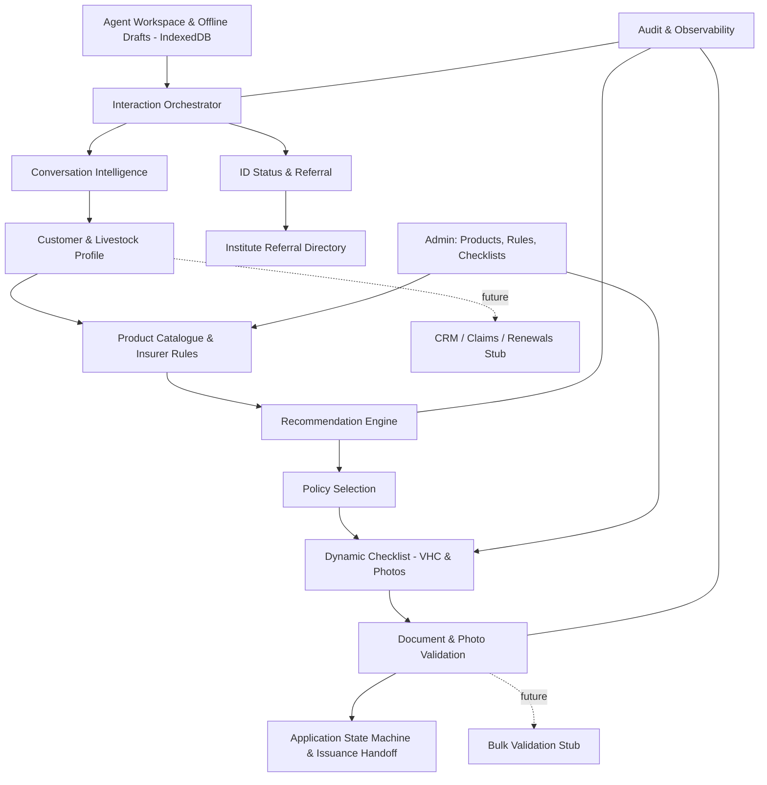

# SureLM — Product Architecture & Sprint Plan

**Document status:** Working implementation baseline  
**Product:** AI-assisted financial distribution for livestock insurance  
**Primary operator:** Insurance agent / distribution partner  
**End customer:** Individual livestock owner, dairy farmer, cooperative, or another eligible livestock-related customer  
**Repository target:** `nandi` (clean-slate bootstrap)

---

## 1. Product objective

SureLM helps an insurance agent understand a customer, identify relevant livestock-insurance needs, recommend a suitable policy, complete the application correctly, validate the required documents and photographic evidence, and move the application through submission toward issuance.

The villager is not expected to understand product taxonomies, navigate complex forms, or operate a separate application. The agent operates SureLM. AI does the classification and adapts the conversation and workflow to the customer.

### Confirmed workflow

1. **Interaction initiation:** The agent starts a customer interaction. In the field, sessions are automatically saved locally in IndexedDB to ensure full resumption during network dropouts.
2. **Conversational profiling:** SureLM uses a simple, conversational workflow to understand who the customer is and the livestock/business context. It infers the customer profile rather than asking the agent or villager to select from a confusing taxonomy.
3. **Early ID check:** Very early in the interaction, SureLM checks whether the livestock has the relevant tagging / identification ID (e.g., RFID, ear tag, INAPH / Bharat Pashudhan tag).
4. **Parallel ID referral:** If the customer does not have an ID, SureLM offers an immediate referral to an appropriate tagging and identification institute.
   - If interested, SureLM records the referral / handoff.
   - The insurance conversation continues in parallel. The referral must not block profiling, recommendation, or other sales activities.
   - If not interested, the sales conversation continues without repeatedly interrupting the customer.
5. **Requirement gathering:** SureLM gathers the customer, livestock, and requirement details needed to identify suitable insurance products.
6. **Explainable recommendation:** SureLM recommends relevant policies with supporting reasons, insurer-specific prerequisites, and any conditions / missing information visible to the agent.
7. **Policy selection & dynamic checklist:** Once a customer selects a policy, SureLM creates a policy-specific, customer-specific **dynamic checklist** and guides the agent through the application tasks.
8. **Document, photo & VHC collection:** Required evidence is collected and validated:
   - Mandatory photographic proof: animal full-body photo, clear/readable ear tag photo, and animal photographed with the owner.
   - Veterinary Health Certificate (VHC): veterinarian certification, age (dentition), milk yield, and general health condition where required by the selected policy.
   - Standard KYC/ownership documents.
   - Validation is individual by default, with a bulk-validation stub for cooperatives and qualifying groups.
9. **Application progression & issuance handoff:** The application moves through an explicit state machine that **decouples application submission eligibility from final policy issuance eligibility**:
   - If the selected insurer and policy allow it, an application can be submitted under `awaiting_tagging_inspection` to initiate underwriting while tagging/inspection completes.
   - If the insurer strictly mandates physical tagging prior to submission, the application remains in `awaiting_tagging_inspection` until the tag and photos are validated, after which it transitions to `ready_for_submission`.
   - Final `issued` status is strictly gated on complete verification, tag confirmation, and insurer binding.
10. **CRM & servicing extension:** Capabilities for follow-ups, renewals, claims, and customer servicing are reserved as structured stubs in the architecture and do not delay the core sales-to-issuance workflow.

### Product principles

- **Agent-led, AI-assisted:** The agent is the operator; the villager is the beneficiary.
- **Conversation before forms:** Ask simple, relevant questions in sequence. Do not expose internal taxonomies to the villager.
- **Progressive profiling:** Ask only for information that is missing and relevant to the next decision.
- **Parallel ID referral:** A missing ID is a parallel action, not a reason to abandon or pause the insurance opportunity.
- **Configurable submission vs. issuance gates:** Decouple application submission from final issuance based on insurer-specific rules. Never assume every insurer allows submission prior to tagging.
- **Verifiable physical & medical evidence:** Enforce mandatory photo capture (full body, readable ear tag, animal with owner) with capture metadata (timestamps, consented geolocation) and Veterinary Health Certificates (VHC) tailored to policy rules.
- **Offline-resilient field operation:** Support field connectivity drops through resumable sessions and queued background sync via IndexedDB. Never store sensitive customer documents or personal data in plaintext `localStorage`.
- **Explainable recommendations:** Show why a policy is relevant, what assumptions were used, and what remains unverified.
- **Policy-driven application:** The selected policy and customer profile determine the checklist and validation rules.
- **Human control:** The agent reviews customer facts, recommendations, documents, photos, and application data before submission.
- **No fabricated eligibility or issuance:** AI assists with extraction and explanations, but only verified product rules and authoritative insurer responses can establish eligibility, acceptance, or issuance.

---

## 2. Scope boundaries

### Initial build (core path)

- Agent workspace with offline-resilient interaction lifecycle and resumable sessions (IndexedDB)
- AI-assisted conversation and customer-profile extraction
- Customer / organisation categorisation inferred from conversation
- Early livestock ID check and parallel referral handoff
- Livestock and customer requirement profile
- Product catalogue and explainable recommendation engine
- Policy selection with insurer-specific rule evaluation
- Dynamic checklist generation (incorporating VHC and photographic proof)
- Individual document and photo upload, capture metadata, OCR/image quality extraction, and validation
- Formal application lifecycle state machine (`profile_incomplete`, `awaiting_tagging_inspection`, `ready_for_submission`, `submitted`, `underwriting_review`, `issued`, `rejected`)
- Application review and insurer submission / issuance tracking
- Audit trail and operational visibility

### Explicit stubs / extension points

These are represented in the product and architecture with clean contracts but should not become full implementation work in the first release:

- **Bulk / mass document validation:** Group application, batch upload, batch status, and per-record result model for cooperatives.
- **CRM & Claims:** Customer lifecycle, follow-ups, renewals, service history, and claims intimation references.
- **Institute integration:** Initial referral / contact handoff. Direct appointment scheduling and institute-side status webhooks are future extensions.
- **Voice capture:** Conversation input boundary is channel-agnostic; voice and transcription adapters can plug in without redesigning workflow logic.

### Not the product

- A general livestock-management platform
- A cattle-ID registration authority
- A direct-to-consumer insurance marketplace that removes the agent
- An AI system that independently binds coverage or guarantees policy issuance

---

## 3. Recommended architecture

### Architecture style: modular monolith first

SureLM is structured as a **modular monolith**: one deployable application and primary database, with strict module ownership and boundaries. This enables rapid end-to-end iteration without distributed microservice overhead.

Modules communicate through typed public interfaces. Separate deployments or microservices will only be introduced when justified by compliance, scale, or organizational boundaries.

### Technology baseline (clean-slate bootstrap in `nandi`)

The `nandi` repository is a clean slate. The foundational stack will be bootstrapped directly here:

- **Web application & API:** Next.js 16 (App Router), React 19, TypeScript, Tailwind CSS
- **Primary data store:** PostgreSQL managed through Prisma ORM (compatible with Neon / standard Postgres)
- **Client storage & offline resilience:** Service Worker and IndexedDB for resumable field drafts, interaction state, and queued uploads (sensitive PII and documents are excluded from unencrypted `localStorage`)
- **Semantic retrieval:** Qdrant vector database for product knowledge and guideline retrieval
- **LLM / inference gateway:** Modular gateway routing to local Ollama or hosted providers (e.g. Gemini, OpenAI) with prompt/model provenance tracking
- **Authentication:** Standard session/token-based authentication supporting role-based access for field agents, supervisors, and admins

*(Note: If migrating components from a prior SureLM prototype in the future, that will be executed as a controlled code import against these module interfaces.)*

### Logical component view



### Request / interaction sequence

```mermaid
sequenceDiagram
    actor Agent
    participant UI as Agent Workspace (IndexedDB)
    participant Flow as Interaction Orchestrator
    participant AI as Conversation Intelligence
    participant Profile as Customer Profile
    participant ID as ID Referral
    participant Rec as Recommendation Engine
    participant Checklist as Dynamic Checklist
    participant Docs as Document & Photo Validation
    participant App as Application State Machine
    
    Agent->>UI: Start interaction (Local draft initialized)
    UI->>Flow: Create/sync interaction
    Flow->>AI: Begin guided conversation
    AI->>Profile: Extract & propose facts
    Flow->>ID: Check livestock ID status early
    ID-->>UI: ID present / absent / unknown
    alt ID absent and customer interested
        UI->>ID: Record referral handoff
        Note over ID,Rec: Referral runs in parallel; sales workflow proceeds
    else ID absent and customer not interested
        Note over ID,Rec: Record declined decision; continue sales flow
    end
    AI->>Profile: Continue progressive profiling
    Profile-->>Rec: Verified customer & livestock facts
    Rec-->>UI: Ranked policy options & insurer conditions
    Agent->>UI: Confirm policy selection
    UI->>Checklist: Generate checklist (VHC, 3-angle photos, KYC)
    Checklist-->>UI: Tasks & evidence requirements
    Agent->>Docs: Capture photos (full body, ear tag, owner+animal) & upload VHC
    Docs-->>UI: Validation results, quality scores, exceptions
    Agent->>App: Review application
    alt Insurer allows pending tagging
        App->>App: Transition to 'awaiting_tagging_inspection' or 'ready_for_submission'
    else Insurer strictly requires tag before submission
        App->>App: Block submission until tag photo verified
    end
    App-->>UI: Final submission / issuance status
```

---

## 4. Module breakdown

Each module owns its business logic and database models. Cross-module calls use typed public interfaces rather than direct cross-table modifications.

### M1. Agent Workspace, Shell & Offline Drafts

**Purpose:** The unified interface used by field agents, with full tolerance for intermittent rural connectivity.

**Responsibilities:**
- Agent authentication and role-aware access
- Start, resume, and close interactions
- Maintain local-first interaction state and queued form inputs in **IndexedDB**
- Surface network connectivity status (online, offline, syncing)
- Present conversation, extracted facts, ID referral status, recommendations, checklist, and document/photo status
- Support low-literacy field interactions: concise local-language prompts, high-contrast UI, minimal typing, zero jargon menus

**Owns:** UI state, local IndexedDB drafts, sync queue, client-side preferences.  
**Security rule:** Sensitive documents and customer PII are never stored in plaintext `localStorage`.

### M2. Interaction Orchestrator

**Purpose:** Manage interaction lifecycle, session transitions, and coordinated workflows.

**Responsibilities:**
- Create, resume, sync, and close interactions
- Coordinate between conversation intelligence, profile updates, ID referrals, recommendations, checklists, and application states
- Preserve parallel workstreams (ensuring ID referral remains independent from sales progression)
- Handle idempotent actions and safe replay of queued offline requests
- Emit domain events and audit entries

**Owns:** Interaction lifecycle state and orchestration event logs.

### M3. Conversation Intelligence

**Purpose:** Transform natural conversation into verified profile facts and targeted follow-up questions.

**Responsibilities:**
- Formulate simple, single-topic conversational prompts
- Infer customer/organization classification internally
- Extract candidate facts with evidence, confidence score, and timestamp
- Flag contradictory or ambiguous answers for agent clarification
- Generate explanations for recommendations and requirements

**Input boundary:** Channel-agnostic text input with an extensible adapter for future voice/transcription integration.  
**Guardrail:** AI output is always classified as `unverified` until confirmed by the agent or verified by deterministic rules.

### M4. Customer, Organisation & Livestock Profile

**Purpose:** Maintain the canonical profile data for customers, farms, cooperatives, and livestock units.

**Responsibilities:**
- Support individuals, households, commercial farms, and cooperatives without rigid UI menus
- Link organizations to members, livestock records, and policies
- Track livestock attributes: breed, species, age/dentition, milk yield, purchase value, health history
- Store tag/ID status: tag number, tag type (RFID, visual ear tag, injectable), issuer, verification state
- Maintain fact provenance and verification history

**Owns:** Customer, Organisation, Member, LivestockRecord, and ProfileFact models.

### M5. Livestock ID Status & Institute Referral

**Purpose:** Detect missing livestock identification early and execute optional institute referrals in parallel.

**Responsibilities:**
- Detect ID status early: `present`, `absent`, `unknown`, `not_applicable`
- Clearly explain the value of tagging/identification in plain language
- Capture customer interest in an institute referral
- If interested, generate a referral handoff to an institute from the directory
- Track referral status independently from the insurance interaction
- Interface with M10 to determine whether an application with an uncompleted referral can be submitted under `awaiting_tagging_inspection`

**Owns:** LivestockIdentifier, IdReferral, and Institute directory models.

### M6. Insurance Product Catalogue & Insurer Rules

**Purpose:** Curate trusted insurance policy specifications, underwriting rules, and insurer-specific constraints.

**Responsibilities:**
- Store policy variants, coverage limits, exclusions, premium formulas, and approved policy documents
- Represent **insurer-specific submission and issuance rules**:
  - `requiresTagForSubmission`: boolean (whether an ID is mandatory to submit)
  - `allowsPendingTaggingInspection`: boolean (whether the insurer accepts `awaiting_tagging_inspection` submissions)
  - `requiresTagForIssuance`: boolean (strictly true for all standard livestock policies)
  - `requiresVhc`: boolean (whether a Veterinary Health Certificate is required)
  - `vhcRequirements`: specific fields required (e.g. dentition age check, milk yield test, vaccination record)
- Maintain versioned product rules with effective dates
- Serve structured rule evaluations to the recommendation and checklist engines

**Owns:** InsuranceProduct, ProductRule, InsurerConstraint, and ChecklistTemplate definitions.

### M7. Recommendation Engine

**Purpose:** Match customer profiles and livestock data against eligible insurance products.

**Responsibilities:**
- Filter candidate policies using deterministic eligibility rules
- Identify missing facts needed to confirm eligibility
- Rank policies based on customer requirements, coverage scope, and cost
- Provide plain-language explanations of why a policy was recommended, its key conditions, and any required post-submission steps
- Record recommendation history and customer selection/opt-out decisions

**Owns:** RecommendationRun and RecommendationOutcome models.

### M8. Policy Selection & Dynamic Checklist

**Purpose:** Convert selected policy rules into an actionable, policy-specific, and customer-specific application checklist.

**Responsibilities:**
- Trigger checklist generation immediately upon policy selection
- Assemble requirements based on selected policy version, customer profile, and livestock type
- Dynamically inject requirements for:
  - **Photographic proof:** Animal full-body photo, ear-tag close-up, animal with owner
  - **Veterinary Health Certificate (VHC):** Veterinarian signoff, dentition age confirmation, milk yield verification
  - **Customer KYC & ownership proof**
  - **Pre-submission vs. post-submission tagging tasks** based on insurer rules
- Track item status: `required`, `conditional`, `optional`, `completed`, `waived`, `blocked`
- Snapshot checklist instances to protect active applications from unexpected catalogue updates

**Owns:** ChecklistInstance and ChecklistItem records.

### M9. Document & Photographic Evidence Management & Validation

**Purpose:** Securely collect, process, and validate required documents, photos, and medical certificates.

**Responsibilities:**
- Upload and store files in secure private object storage (e.g. S3/GCS or local encrypted blob equivalent)
- **Mandatory photographic capture:**
  - Full-body side profile of the animal
  - High-resolution, readable close-up of the ear tag / RFID
  - Animal photographed alongside the owner/agent
- **Capture metadata recording:** Capture timestamp, device info, and consented geolocation coordinates
- **Automated image quality & OCR checks:** Check for blur, adequate lighting, and tag number readability; extract VHC fields (vet license number, date, certified health status)
- **Validation routing:** Return `pass`, `fail`, or `needs_review` with detailed reason codes; route low-confidence extraction to mandatory agent review
- Preserve full document/photo version and validation history

**Owns:** Document, PhotoEvidence, ValidationResult, and ReviewLog records.

### M10. Application State Machine & Issuance Handoff

**Purpose:** Manage the formal lifecycle of an insurance application and govern submission and issuance readiness.

**The Application State Machine:**
1. `profile_incomplete`: Customer, livestock, and requirements gathering in progress.
2. `awaiting_tagging_inspection`: Customer and policy selected, but tagging or veterinary inspection is pending. If permitted by insurer rules (`allowsPendingTaggingInspection = true`), the application may be reviewed and submitted in this state; otherwise, it must await tag completion.
3. `ready_for_submission`: All policy-mandated pre-submission checklist items (documents, photos, declarations) are verified.
4. `submitted`: Application transmitted to the insurer partner (via API, portal integration, or controlled handoff).
5. `underwriting_review`: Insurer or partner underwriting review in progress.
6. `issued`: Policy bound and issued (requires complete tag verification, valid VHC, and confirmed insurer acceptance).
7. `rejected`: Application declined by the insurer or agent with logged reasons.

**Core governance:** Separates submission eligibility from issuance eligibility. Ensures an application is never prematurely marked `issued` while preserving sales momentum when insurers allow early submission.

**Owns:** Application, ApplicationStateTransition, SubmissionAttempt, and PolicyIssuance records.

### M11. Bulk / Mass Document Validation — STUB

**Purpose:** Structured extension point for cooperative and multi-animal group applications.

**Initial stub provides:**
- Group/cooperative batch identifiers
- Batch upload endpoint and data contracts
- Traceable per-member and per-livestock document mapping
- Batch progress summary and explicit `not_implemented` / queued mock responses

**Owns:** BulkBatch and BatchItemStub models.

### M12. CRM, Claims & Servicing — STUB

**Purpose:** Structured extension point connecting sales completion to post-issuance servicing.

**Initial stub provides:**
- Customer and policy interaction timeline
- Follow-up task and renewal reference models
- Claims case intimation contract (`claim_intimated`, `inspector_assigned`, `settled`)

**Owns:** CrmCase and ClaimCaseStub models.

### M13. Admin, Knowledge & Audit

**Purpose:** Provide governance, auditability, and configuration management.

**Responsibilities:**
- Maintain insurer catalogues, rule versions, checklist templates, and institute directories
- Record comprehensive audit logs for all agent actions, AI suggestions, human overrides, and status transitions
- Track model/prompt versions, extraction confidence scores, and raw evidence references
- Provide supervisor review dashboards

**Owns:** AdminConfig, RuleVersion, PromptMetadata, and AuditLog records.

---

## 5. Module contracts and event boundaries

Modules interact through typed TypeScript contracts and emit domain events across the workflow lifecycle.

### Key synchronous operations

| Producer | Consumer | Contract / operation |
|---|---|---|
| Workspace | Orchestrator | `startInteraction`, `resumeInteraction`, `syncOfflineDraft` |
| Orchestrator | Conversation | `processConversationalInput`, `getNextQuestion` |
| Conversation | Profile | `proposeProfileFacts` |
| Workspace / Orchestrator | ID Referral | `checkIdStatus`, `recordIdDecision`, `createReferralHandoff` |
| Profile | Recommendation | `getRecommendationContext` |
| Product Rules | Recommendation | `evaluatePolicyEligibility`, `getInsurerPrerequisites` |
| Policy Selection | Checklist | `generateChecklistInstance`, `recalculateChecklist` |
| Checklist | Document & Photos | `getPendingEvidenceRequirements` |
| Document & Photos | Checklist | `recordEvidenceValidation` (photos, VHC, KYC) |
| Application | Checklist / Rules | `evaluateSubmissionReadiness`, `evaluateIssuanceReadiness` |
| Application | Insurer Adapter | `submitApplication`, `pollApplicationStatus` |

### Domain events

- `InteractionStarted`
- `DraftSynced`
- `ProfileFactProposed`
- `ProfileFactConfirmed`
- `CustomerTypeInferred`
- `LivestockIdStatusRecorded`
- `IdReferralCreated`
- `IdReferralDeclined`
- `RecommendationGenerated`
- `PolicySelected`
- `ChecklistCreated`
- `PhotoEvidenceCaptured` (full-body, ear-tag, owner+animal)
- `DocumentValidationCompleted`
- `ApplicationStateChanged` (`profile_incomplete` -> `awaiting_tagging_inspection` -> `ready_for_submission` -> `submitted` -> `underwriting_review` -> `issued` / `rejected`)
- `ApplicationSubmitted`
- `PolicyIssued`
- `ApplicationRejected`
- `BulkValidationRequested` (stub)
- `ClaimCaseReferenced` (stub)

**Parallel-flow rule:** `IdReferralCreated` and `IdReferralDeclined` are independent domain events. Neither event blocks `RecommendationGenerated`, `PolicySelected`, or the transition to `awaiting_tagging_inspection`.

---

## 6. Core data model (conceptual)

| Entity | Purpose / key relationships |
|---|---|
| `Agent` | Authenticated operator linked to field interactions and applications |
| `Customer` | Primary customer identity; linked to interactions and livestock |
| `Organisation` | Cooperative / farm entity; holds multiple members and livestock units |
| `OrganisationMember` | Join entity linking an organisation to a customer |
| `LivestockRecord` | Animal profile (species, breed, dentition/age, milk yield, valuation) |
| `LivestockIdentifier` | Tag/ID number, type (RFID/visual), photo reference, verification status |
| `Interaction` | Agent interaction session; links to drafts and independent referral status |
| `FieldDraft` | Client-side IndexedDB model for offline form state and queued sync items |
| `ProfileFact` | Structured attribute, evidence, confidence, source, and verification state |
| `Institute` | Referral destination directory with contact and coverage metadata |
| `IdReferral` | Customer, livestock, institute, interest decision, and handoff tracking |
| `InsuranceProduct` | Product catalogue entry, insurer reference, and version |
| `ProductRule` | Eligibility gates, submission rules (`requiresTagForSubmission`), and issuance gates |
| `RecommendationRun` | Input context, ranked candidate policies, rationale, and missing facts |
| `PolicySelection` | Customer selection linked to specific recommendation and product versions |
| `ChecklistTemplate` | Master template specifying required docs, 3-angle photos, and VHC rules |
| `ChecklistInstance` | Point-in-time snapshot generated for an application |
| `ChecklistItem` | Specific requirement task, status, and linked evidence ID |
| `Document` | Document metadata, secure storage URI, category (KYC, VHC, ownership) |
| `PhotoEvidence` | Animal photos (full body, ear tag, owner+animal), capture metadata, quality score |
| `CaptureMetadata` | Timestamp, GPS coordinates (where consented), device info |
| `Application` | Core application record; holds fine-grained state machine status |
| `SubmissionAttempt` | Insurer submission payload, external reference, response, and retry counter |
| `BulkBatch` | Stub for cooperative multi-animal batch processing |
| `CrmCase` | Stub for post-issuance follow-ups, renewals, and claims |
| `AuditEvent` | Actor, action, target entity, timestamp, and audit metadata |

---

## 7. AI and rules responsibilities

### Use AI for

- Natural conversational dialogue understanding
- Inferring customer / organisation classification from dialogue context
- Extracting candidate profile facts with confidence scores
- Identifying missing or contradictory facts and formulating the next question
- Explaining policy recommendations using approved product rules
- Assisting document/photo quality checks (blur, illumination, OCR tag legibility)
- Flagging anomalies for agent review

### Use deterministic rules / verified data for

- Eligibility gates and underwriting exclusions
- Insurer-specific submission vs. issuance prerequisite checks
- Dynamic checklist composition
- Evaluation of application state transitions
- Premium calculations (using insurer-approved formulas)
- Document/photo verification signoff (final pass/fail requires meeting deterministic criteria or agent confirmation)
- Insurer handoff and policy issuance binding

### Required AI response structure

Every AI extraction or recommendation must return:
- Proposed value or recommendation
- Source evidence (conversation turn, document reference, or product rule)
- Confidence indicator (`high`, `medium`, `low`)
- Verification state (`unverified`, `agent_confirmed`, `externally_verified`, `rejected`)
- Prompt and model version identifier

Low-confidence extractions must never be silently promoted to confirmed facts without explicit agent review.

---

## 8. Security, privacy, offline resilience & operations

- **Role-based access control (RBAC):** Strict permissions for agents, supervisors, and administrators. Agents only access records within their assigned territory or customer portfolio.
- **Offline data protection:**
  - Client drafts and queued actions are stored in **IndexedDB**.
  - **No sensitive customer documents, biometric data, or identity documents are stored unencrypted in plaintext `localStorage`**.
  - Sync queue encrypts payload data at rest on device where supported, and purges temporary local blobs immediately upon successful server confirmation.
- **Consent and geolocation:**
  - Explicit customer consent is recorded before capturing geolocation coordinates or uploading personal documents.
  - GPS metadata is strictly bound to photo evidence for underwriting verification and excluded from public payloads.
- **Data storage encryption:** All documents and photographic assets are stored in private, encrypted object storage with time-limited signed URLs.
- **Auditability & immutability:** Every state transition in the application state machine is logged in `AuditEvent` with timestamp, actor, and before/after states.
- **Idempotency:** All submission, upload, and referral APIs implement idempotency keys to ensure safe retries over unstable field networks.

---

## 9. Sprint plan

The sprint plan establishes a clean-slate bootstrap in `nandi` and delivers working vertical increments.

### Sprint 0 — Repository bootstrap & architectural baseline

**Goal:** Initialize the clean-slate `nandi` repository with complete architecture foundations, database schema, and module contracts.

**Work:**
- Bootstrap Next.js 16 (App Router), React 19, TypeScript, and Tailwind CSS.
- Set up Prisma with PostgreSQL (Neon-ready schema).
- Create the modular directory structure under `src/modules/` (`workspace`, `interaction`, `profile`, `id-referral`, `catalogue`, `recommendation`, `checklist`, `documents`, `application`, `stubs`).
- Define shared domain types, application state enums, and module service interfaces.
- Create seed data for agents, sample customers, livestock breeds, product rules, and tagging institutes.
- Configure CI pipeline for linting, type-checking, and unit tests.

**Deliverables:**
- Runnable baseline application in `nandi`
- Applied database migrations and seed script
- Typed module contracts and interface definitions
- Automated CI pipeline

**Acceptance criteria:**
- Application compiles and runs locally with `npm run dev`.
- Database seeds successfully with zero errors.
- Module boundaries are enforced via clean TypeScript barrel exports.

### Sprint 1 — Agent workspace, interaction lifecycle & offline drafts

**Goal:** Agent can initiate, conduct, and resume interactions with offline resilience via IndexedDB.

**Work:**
- Build agent interaction shell and session management UI.
- Implement client-side IndexedDB persistence for active drafts and field inputs.
- Add network connectivity detector (online/offline banner and queued sync indicator).
- Implement interaction lifecycle APIs (`create`, `resume`, `syncDraft`, `close`).
- Connect customer lookup and minimal customer creation flow.

**Deliverables:**
- Agent workspace shell with offline indicator
- IndexedDB draft synchronization layer
- Interaction orchestrator module

**Acceptance criteria:**
- Agent can start an interaction, disconnect network, continue inputting facts, and reconnect with automatic draft sync.
- Reloading the browser restores the exact interaction state from IndexedDB.
- Interaction records link cleanly to authenticated agents.

### Sprint 2 — Conversational profiling & customer inference

**Goal:** AI guides the conversation, infers customer context, and builds a structured profile.

**Work:**
- Implement conversational turn API and prompt management.
- Build extraction engine for customer, farm scale, livestock count, and ownership.
- Implement internal classification inference (individual owner vs. commercial dairy vs. cooperative).
- Build progressive question selection based on missing profile fields.
- Build agent fact-review UI with confidence scores and manual override controls.

**Deliverables:**
- Conversation intelligence module
- Profile management service
- Fact review and editing component

**Acceptance criteria:**
- Conversation extracts structured facts without requiring manual taxonomy selection.
- Questions focus strictly on missing policy-relevant facts.
- Unclear facts are surfaced to the agent for confirmation.

### Sprint 3 — Early ID check, parallel referral & state machine integration

**Goal:** Early identification check offers parallel institute referral without interrupting sales.

**Work:**
- Inject early livestock ID prompt into the conversation flow.
- Record ID status (`present`, `absent`, `unknown`, `not_applicable`).
- Build institute referral handoff flow with institute directory lookup.
- Ensure referral creation runs in parallel and leaves interaction stage active.
- Wire initial application state to `profile_incomplete` or `awaiting_tagging_inspection`.

**Deliverables:**
- Livestock ID & Referral module
- Institute directory seed and management UI
- Parallel referral status indicator in workspace

**Acceptance criteria:**
- If ID is missing and customer agrees, referral is created and recorded.
- Sales profiling and policy recommendation proceed immediately without waiting for referral completion.
- If customer declines referral, decision is logged and sales flow continues smoothly.

### Sprint 4 — Product catalogue, insurer rules & explainable recommendation

**Goal:** Recommend relevant policies using deterministic rules and explainable AI.

**Work:**
- Implement product catalogue with versioned rules.
- Model insurer-specific constraints: `requiresTagForSubmission`, `allowsPendingTaggingInspection`, and VHC rules.
- Build deterministic recommendation filter and ranking engine.
- Generate plain-language policy explanations and highlight prerequisites/exclusions.
- Build policy comparison UI for the agent.

**Deliverables:**
- Product catalogue service and seed policies
- Recommendation engine
- Agent policy comparison card view

**Acceptance criteria:**
- Test profiles return expected policies matching seeded rules.
- Recommendations clearly state why they match, any missing facts, and post-selection requirements.
- Hard disqualifiers immediately exclude ineligible policies.

### Sprint 5 — Policy selection & dynamic checklist (VHC & photos)

**Goal:** Selecting a policy generates a dynamic checklist tailored to policy rules and customer profile.

**Work:**
- Implement policy selection capture.
- Build dynamic checklist engine generating point-in-time snapshots.
- Inject mandatory photographic evidence requirements (full-body, ear tag close-up, animal with owner).
- Inject Veterinary Health Certificate (VHC) requirements (health, dentition, milk yield).
- Configure pre-submission vs. post-submission tagging tasks based on insurer rules.
- Build interactive checklist progress tracker UI.

**Deliverables:**
- Policy selection service
- Dynamic checklist engine
- Checklist UI with status indicators

**Acceptance criteria:**
- Selecting a policy creates a snapshot checklist tied to the selected policy version.
- Checklist includes 3-angle photo tasks and policy-specific VHC items.
- Item dependencies are enforced (e.g. VHC requires vet license number).

### Sprint 6 — Document & photographic evidence capture & validation

**Goal:** Collect and validate required documents, 3-angle animal photos, and VHC.

**Work:**
- Implement photo/document capture with camera integration.
- Capture metadata: timestamp, device info, and consented geolocation coordinates.
- Implement quality checks for photos (blur, illumination, ear tag readability).
- Implement document extraction for VHC (vet signoff, age by dentition, milk yield).
- Build agent exception review screen for low-confidence or failed validations.
- Automatically update checklist item completion states.

**Deliverables:**
- Document and photo management service
- Evidence validation pipeline
- Agent review and manual confirmation UI

**Acceptance criteria:**
- Agent can capture 3-angle animal photos and VHC.
- Metadata (timestamp, coordinates) is captured upon consent.
- Blurry photos or illegible ear tags trigger a warning and request a retake.
- Checklist updates dynamically as evidence passes validation.

### Sprint 7 — Application state machine & issuance handoff

**Goal:** Complete the full application state machine and handle insurer submission/issuance handoff.

**Work:**
- Implement the formal Application State Machine:
  - `profile_incomplete`
  - `awaiting_tagging_inspection`
  - `ready_for_submission`
  - `submitted`
  - `underwriting_review`
  - `issued` / `rejected`
- Enforce the separation between **submission eligibility** and **issuance eligibility**:
  - Allow submission under `awaiting_tagging_inspection` only if permitted by insurer rules.
  - Require full tag verification and VHC signoff before transitioning to `issued`.
- Build application summary review screen with customer declarations.
- Implement insurer submission adapter (supporting API or controlled handoff) with idempotency keys.
- Track submission attempts, reference numbers, and issuance events.

**Deliverables:**
- Application state machine engine
- Submission handoff adapter
- Application review and tracking interface

**Acceptance criteria:**
- Applications strictly follow valid state transitions.
- An application cannot be submitted if pre-submission rules are unmet.
- Where allowed, an application can be submitted pending tagging, but cannot reach `issued` until the tag is verified.
- Submission attempts are recorded with unique reference IDs.

### Sprint 8 — Bulk validation & CRM/claims stubs

**Goal:** Establish clean, functional stubs for group applications and ongoing customer servicing.

**Work:**
- Implement cooperative/group entity relationships (organisation with individual traceable members and animals).
- Build bulk validation stub: batch model, multi-record upload entry point, progress indicator, and explicit `not_implemented` status response.
- Build CRM/Claims stub: customer interaction timeline, renewal reminders, and claim intimation case model.

**Deliverables:**
- Bulk validation stub module
- CRM & Claims stub module
- Stable domain interfaces for future implementation

**Acceptance criteria:**
- Group applications preserve individual member and animal traceability.
- Stubs provide realistic UI screens that clearly communicate their placeholder status without breaking the main flow.
- Core sales and issuance path remains completely unaffected.

### Sprint 9 — End-to-end hardening, field connectivity & pilot readiness

**Goal:** Harden the system against real-world field conditions and validate all acceptance scenarios.

**Work:**
- Execute end-to-end testing for all core scenarios (individual owner, ID present, ID missing + referral, ID missing + declined, cooperative group).
- Test offline resilience: simulated network disconnection during profiling, document capture, and recovery.
- Validate security: verify no plaintext PII or documents exist in `localStorage`, and test signed URL expirations.
- Test edge cases: image quality failures, submission timeouts, retry idempotency.
- Validate UI copy and readability for field agents.

**Deliverables:**
- Pilot-ready application build
- Comprehensive test scenario suite and verification report
- Agent onboarding quick-start guide

**Acceptance criteria:**
- All end-to-end acceptance scenarios pass.
- Network interruption at any step does not cause data loss.
- Full audit trail is generated for all test interactions.

---

## 10. Suggested parallel workstreams

| Workstream | Modules | Prerequisites | Integration boundary |
|---|---|---|---|
| **Agent Experience & Offline** | M1 | Sprint 0 contracts | Workspace UI, IndexedDB sync, checklist views |
| **Conversation & Profile** | M2, M3, M4 | Sprint 0 contracts | Profile facts, conversational turn APIs |
| **ID Referral & Institutes** | M5 | Profile & Interaction contracts | Independent referral state & events |
| **Product Rules & Recommendations** | M6, M7 | Profile & Rule contracts | Recommendation API & eligibility evaluation |
| **Evidence & Application Workflow** | M8, M9, M10 | Product & Checklist contracts | Dynamic checklist, evidence validation, state machine |
| **Future Extensions** | M11, M12 | Domain entity contracts | Typed stubs and navigation routes |
| **Governance & Security** | M13 | Initial domain contracts | Audit logging, RBAC, admin interfaces |

---

## 11. End-to-end acceptance scenarios

### Scenario A — Individual livestock owner, ID already present

1. Agent starts interaction in workspace (local draft created in IndexedDB).
2. AI converses with agent, infers individual farmer profile, and records livestock facts.
3. Customer confirms livestock has an active RFID / ear tag; tag number is recorded.
4. Policy recommendation matches customer needs and shows eligible products.
5. Customer selects a policy.
6. Dynamic checklist generates required items: 3-angle photos (full body, ear tag, owner+animal), VHC, and KYC.
7. Agent captures photos (with consented timestamp/GPS) and uploads VHC.
8. Validation checks pass; application transitions from `profile_incomplete` to `ready_for_submission`.
9. Agent reviews summary, captures declarations, and submits application (`submitted` -> `underwriting_review` -> `issued`).

### Scenario B1 — ID missing, referral accepted, insurer permits submission pending tagging

1. Agent starts interaction; AI checks ID status early and detects tag is absent.
2. Customer expresses interest in tagging; SureLM generates institute referral handoff.
3. Sales conversation continues immediately in parallel without interruption.
4. Policy recommendation identifies an insurer whose rules permit `allowsPendingTaggingInspection = true`.
5. Customer selects policy; checklist flags tagging/inspection as pending institute handoff.
6. Required non-tag documents and pre-inspection photos are collected.
7. Application transitions to `awaiting_tagging_inspection` and moves to `ready_for_submission` under the insurer's conditional submission rule.
8. Application is submitted to insurer as pending inspection/tagging (`submitted`).
9. Institute/vet tags animal; ear tag photo and final VHC are validated.
10. Insurer binds coverage and application transitions to `issued`.

### Scenario B2 — ID missing, referral accepted, insurer strictly mandates tag prior to submission

1. Steps 1–5 proceed as in Scenario B1.
2. Selected insurer rule specifies `requiresTagForSubmission = true`.
3. Application enters `awaiting_tagging_inspection`.
4. Submission button remains disabled with a clear explanation: *"Insurer requires ear tag verification prior to application submission."*
5. Tagging referral completes; agent captures clear ear-tag close-up photo and animal with owner.
6. Photo validation confirms readable tag; application transitions to `ready_for_submission`.
7. Application is submitted and moves through underwriting toward issuance.

### Scenario C — ID missing, referral declined

1. Early ID check reveals animal has no tag.
2. Customer declines institute referral; decision is recorded.
3. Conversation continues without repeated prompting.
4. Recommendation displays policies, but clearly indicates that policies requiring an ID will require physical tagging prior to issuance or submission.
5. If customer selects an ID-mandatory policy, checklist marks tagging task as outstanding/blocked until an ID is arranged.

### Scenario D — Cooperative / group customer

1. AI infers from conversation that customer represents a dairy cooperative.
2. Organisation record is created with linked member and livestock associations.
3. Group policy options are recommended and selected.
4. Checklist generates group-level requirements and per-member schedules.
5. Bulk validation entry point displays batch progress stub with individual animal traceability.

---

## 12. Key decisions and assumptions register

| Topic | Decision / Baseline | Status |
|---|---|---|
| **Primary operator** | Insurance agent operates SureLM on behalf of the customer | Confirmed |
| **End-customer UX** | Villager never navigates complex taxonomies or forms | Confirmed |
| **Customer categorisation** | AI infers profile type from conversation; no manual menu selection | Confirmed |
| **ID check timing** | Executed very early in the interaction flow | Confirmed |
| **Parallel referral** | Missing ID triggers parallel referral; never blocks sales conversation | Confirmed |
| **Submission vs. issuance** | Configurable per insurer/policy; support `awaiting_tagging_inspection` state where allowed; decouple submission readiness from issuance readiness | **Confirmed requirement** |
| **Animal & tag photos** | Mandatory 3-angle photo evidence in M9 (full body, readable tag, owner with animal) with capture metadata (timestamps, consented GPS) and quality review | **Confirmed requirement** |
| **Veterinary Health Certificate** | Explicitly supported in checklist/validation (health, dentition/age, milk yield) governed by policy rules | **Confirmed requirement** |
| **Offline & connectivity** | Resumable sessions via IndexedDB; queued sync; no plaintext PII/documents in `localStorage` | **Confirmed requirement** |
| **Repository baseline** | `nandi` is bootstrapped as a clean slate; migration from prototypes is an external option | **Confirmed requirement** |
| **Application state machine** | Explicit 7-state model (`profile_incomplete`, `awaiting_tagging_inspection`, `ready_for_submission`, `submitted`, `underwriting_review`, `issued`, `rejected`) | **Confirmed requirement** |
| **Bulk validation** | Multi-animal cooperative stub with individual record traceability | Confirmed stub |
| **CRM & Claims** | Post-issuance lifecycle, follow-ups, and claims intimation stub | Confirmed stub |
| **Voice capture** | Channel adapter left open; deferred from initial core path | Deferred |

---

## 13. MVP completion definition

The MVP is complete when an agent can guide a customer through:
1. Conversational discovery and profile inference (with offline resilience and IndexedDB draft recovery).
2. Early livestock ID check and parallel institute referral without blocking the sale.
3. Policy recommendation with plain-language rationale and insurer prerequisite disclosure.
4. Policy selection and dynamic checklist generation.
5. Document, photo (full-body, ear-tag, animal with owner), and VHC collection and validation.
6. Execution of the formal Application State Machine respecting insurer-specific submission vs. issuance rules.
7. Application review and successful handoff for submission.

All cooperative bulk-validation and CRM/claims capabilities must be represented as honest, clearly labelled stubs with stable extension contracts.

**The central product test:** Does SureLM make the agent's job faster, compliant, and error-free while shielding the rural villager from insurance jargon and form complexity? If the villager is forced to interact with technical categories or the agent is blocked by a missing tag when the insurer permits pre-tagging submission, the design has failed.
